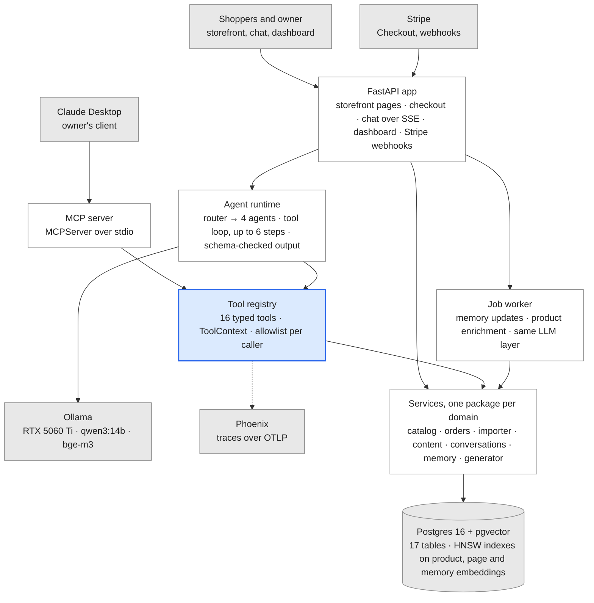

# AI Store Builder — Project Blueprint

> Export of the project blueprint doc at revision 23, taken on 2026-11-13. The doc is the
> source: change it there and export again instead of editing this file. Its two figures are
> embedded widgets that a markdown export cannot carry, so they are redrawn here as a
> Mermaid diagram and a table.

Nov 6, 2026 · @Anas

mcp v2 turns your FastAPI + MCP store backend into an AI store builder in about 200 AI-assisted hours: roughly 14 weeks at 15 h/week, done by mid-February 2027 if you start on November 9.

## Scope

v1 runs on one machine: it turns a product sheet into a working demo store and runs four AI agents on it, with every agent action going through a typed MCP tool. Every table carries a `store_id` from day one, so going multi-store later is a feature, not a rewrite.

**In v1**

- Product import from CSV, a Google Sheets CSV export and a Shopify product export
- Generated storefront from 2–3 fixed templates, with SEO metadata, JSON-LD and a sitemap
- Stripe Checkout in test mode, with orders created from webhooks
- Owner dashboard: onboarding interview, draft approvals, plans and scripts
- A router plus four agents: Copy & SEO, Support, Marketing, UGC scripts
- Business memory with a source for every fact, consolidated after each session
- Evals, tracing and CI for every agent

**Out of v1**

- Drag-and-drop site editor, custom domains, hosting stores for other people
- Live payments, tax calculation, shipping labels
- Video generation, auto-posting to TikTok or Instagram, ad management
- Anything that promises sales

**Done means**

- [ ] A demo store built from a sample product sheet in one sitting, shown via a public link or a recorded walkthrough
- [ ] All four agents and the router pass their golden-set targets (see Evals and observability)
- [ ] Every agent run is traced, and CI runs tests and evals on each pull request
- [ ] README, architecture notes, decision log and a 3-minute demo video

## Starting point

The `mcp` repo already has the right shape: business rules live in framework-free services, and REST and MCP are thin adapters over them. v2 adds a third adapter, the agent runtime, instead of restructuring.

| Area | Today (commit dae2395) | v2 |
| --- | --- | --- |
| Database | SQLite in WAL mode, tables from `create_all` | Postgres 16 + pgvector, Alembic migrations |
| Tables | `products`, `inventory` | + stores, variants, collections, orders, conversations, memory facts, drafts |
| MCP tools | `add_product`, `check_inventory`, `update_price`, `adjust_stock` | 16 tools grouped by domain, each receiving a `ToolContext` from the runtime |
| Clients | Claude Desktop over stdio | Claude Desktop over stdio + in-app agents on Ollama |
| REST | 5 product routes | + dashboard, storefront, chat, import and Stripe webhook routes |
| Tests | 12, including a real MCP stdio session | + Postgres test container and golden-set evals in CI |

**Keep**

- `services.py` as the only place business rules live; adapters stay thin
- Prices as integer cents with `to_cents` / `from_cents`
- Domain errors mapped to `ToolError` for MCP and to HTTP codes for REST
- MCP Python SDK 2.x (`MCPServer`), not v1's `FastMCP`
- The end-to-end MCP test, extended to every new tool

**Change first**

- Split `store/` into one package per domain (see Repository layout)
- Add `store_id` to every table and every service signature
- Replace `init_db()` / `create_all` with Alembic

v2 also finishes the README's own next-steps list: orders with a transactional `create_order`, Alembic, MCP resources such as `store://catalog`, and confirmation for large price changes through MCP elicitation.

## Architecture

Six rows, top to bottom: clients, two entry points (FastAPI and the MCP server), the agent runtime and job worker, the tool registry, the service layer, and Postgres. The tool registry is the single door for anything a model decides to do.

**Agents and Claude Desktop reach the store only through the tool registry.** Pages, checkout and background jobs call services directly; every model-driven action goes through typed tools.



Grey: client, service or infrastructure. White: built in this project. Blue: the only path for agent actions.

*Architecture · 12 components, one tool registry*

A shopper’s question runs FastAPI → agent runtime → tool registry → services → Postgres. Claude Desktop enters through the MCP server and meets the same registry, so both paths get the same permissions and the same business rules.

## Repository layout

One package per domain, each with `models.py`, `schemas.py` and `services.py`. Adapters (`api/`, `mcp_server.py`, `agents/`) import services, never models, and services never import adapters. An import-linter contract in CI keeps it that way.

```text
mcp/
├── pyproject.toml            deps, ruff, pytest, import-linter contracts
├── docker-compose.yml        postgres (pgvector/pgvector:pg16), tracing; app + worker in phase 6
├── alembic.ini
├── migrations/               Alembic revisions
├── server.py                 Claude Desktop entry point (stdio), as today
├── store/
│   ├── config.py             pydantic-settings: DB URL, Ollama URL, model names, Stripe keys
│   ├── db.py                 engine, Base, session_scope()
│   ├── context.py            ToolContext(store_id, actor, agent, conversation_id)
│   ├── errors.py             StoreError hierarchy, moved out of services.py
│   ├── money.py              to_cents / from_cents
│   ├── stores/               store + owner accounts
│   ├── catalog/              products, variants, collections, inventory
│   ├── orders/               orders, Stripe Checkout + webhook handling
│   ├── importer/             csv.py, shopify.py, normalize.py
│   ├── content/              drafts with approve / reject
│   ├── conversations/        sessions and messages
│   ├── memory/               facts, retrieval, consolidate.py
│   ├── generator/            pipeline.py, enrich.py, validate.py
│   ├── storefront/           render.py, seo.py, templates/ (Jinja2 + HTMX)
│   ├── llm/                  provider.py (Protocol), ollama.py, hosted.py, embeddings.py
│   ├── tools/                registry.py (definitions + permissions), one module per domain
│   ├── agents/               runtime.py (tool loop), router.py, one module per agent, prompts/*.md
│   ├── jobs/                 worker.py: Postgres-backed queue (SELECT … FOR UPDATE SKIP LOCKED)
│   ├── api/                  app.py, deps.py, routes/ (dashboard, storefront, chat, imports, webhooks)
│   └── mcp_server.py         MCPServer adapter over tools/registry.py
├── evals/                    datasets/*.jsonl, scorers.py, run_evals.py
├── tests/                    services, api, mcp_e2e, agents (with a fake LLM)
├── scripts/                  seed.py, sample_products.csv
└── docs/                     BLUEPRINT.md (export of this doc), decisions/ (one ADR per choice)
```

During development, run Postgres and tracing in Docker and the Python app natively in a venv; containerize the app only in phase 6. Ollama runs natively on Windows so it sees the eGPU; containers reach it at `host.docker.internal:11434`.

## Data model

Seventeen tables in Postgres 16 with pgvector, all keyed by `store_id`. Money stays in integer cents, inventory keeps its own table as it does today, and embeddings use bge-m3's 1024 dimensions so German and English text share one vector space.

```sql
CREATE EXTENSION IF NOT EXISTS vector;

-- Tenancy
CREATE TABLE stores (
  id          uuid PRIMARY KEY DEFAULT gen_random_uuid(),
  slug        text UNIQUE NOT NULL,                 -- /s/{slug}/ in storefront URLs
  name        text NOT NULL,
  currency    char(3) NOT NULL DEFAULT 'EUR',
  locale      text NOT NULL DEFAULT 'de-DE',
  status      text NOT NULL DEFAULT 'draft' CHECK (status IN ('draft','live')),
  created_at  timestamptz NOT NULL DEFAULT now()
);

CREATE TABLE owners (
  id            uuid PRIMARY KEY DEFAULT gen_random_uuid(),
  store_id      uuid NOT NULL REFERENCES stores(id) ON DELETE CASCADE,
  email         text UNIQUE NOT NULL,               -- lower-cased in the service
  password_hash text NOT NULL,                      -- argon2
  created_at    timestamptz NOT NULL DEFAULT now()
);

-- Catalog
CREATE TABLE products (
  id              bigint GENERATED ALWAYS AS IDENTITY PRIMARY KEY,
  store_id        uuid NOT NULL REFERENCES stores(id) ON DELETE CASCADE,
  handle          text NOT NULL,                    -- URL slug
  title           text NOT NULL,
  description     text,                             -- published copy only
  attributes      jsonb NOT NULL DEFAULT '{}',      -- material, size, care: what the validator checks claims against
  status          text NOT NULL DEFAULT 'draft' CHECK (status IN ('draft','active','archived')),
  seo_title       text,
  seo_description text,
  embedding       vector(1024),
  created_at      timestamptz NOT NULL DEFAULT now(),
  updated_at      timestamptz NOT NULL DEFAULT now(),
  UNIQUE (store_id, handle)
);

CREATE TABLE variants (
  id          bigint GENERATED ALWAYS AS IDENTITY PRIMARY KEY,
  store_id    uuid NOT NULL REFERENCES stores(id) ON DELETE CASCADE,
  product_id  bigint NOT NULL REFERENCES products(id) ON DELETE CASCADE,
  sku         text NOT NULL,
  options     jsonb NOT NULL DEFAULT '{}',          -- {"size": "M", "color": "Black"}
  price_cents integer NOT NULL CHECK (price_cents > 0),
  UNIQUE (store_id, sku)
);

CREATE TABLE inventory (                            -- split from variants so stock writes never lock catalog rows
  variant_id  bigint PRIMARY KEY REFERENCES variants(id) ON DELETE CASCADE,
  quantity    integer NOT NULL DEFAULT 0 CHECK (quantity >= 0),
  updated_at  timestamptz NOT NULL DEFAULT now()
);

CREATE TABLE product_images (
  id          bigint GENERATED ALWAYS AS IDENTITY PRIMARY KEY,
  product_id  bigint NOT NULL REFERENCES products(id) ON DELETE CASCADE,
  url         text NOT NULL,
  alt_text    text,
  position    smallint NOT NULL DEFAULT 0
);

CREATE TABLE collections (
  id          bigint GENERATED ALWAYS AS IDENTITY PRIMARY KEY,
  store_id    uuid NOT NULL REFERENCES stores(id) ON DELETE CASCADE,
  handle      text NOT NULL,
  title       text NOT NULL,
  description text,
  UNIQUE (store_id, handle)
);

CREATE TABLE collection_products (
  collection_id bigint REFERENCES collections(id) ON DELETE CASCADE,
  product_id    bigint REFERENCES products(id) ON DELETE CASCADE,
  position      smallint NOT NULL DEFAULT 0,
  PRIMARY KEY (collection_id, product_id)
);

-- Policies and FAQ: the Support agent's retrieval source
CREATE TABLE store_pages (
  id         bigint GENERATED ALWAYS AS IDENTITY PRIMARY KEY,
  store_id   uuid NOT NULL REFERENCES stores(id) ON DELETE CASCADE,
  kind       text NOT NULL CHECK (kind IN ('shipping','returns','faq','about','legal')),
  title      text NOT NULL,
  body_md    text NOT NULL,
  embedding  vector(1024)
);

-- Orders
CREATE TABLE orders (
  id                bigint GENERATED ALWAYS AS IDENTITY PRIMARY KEY,
  store_id          uuid NOT NULL REFERENCES stores(id) ON DELETE CASCADE,
  public_id         text UNIQUE NOT NULL,           -- shown to shoppers, e.g. MM-1042
  email             text NOT NULL,
  status            text NOT NULL DEFAULT 'pending'
                    CHECK (status IN ('pending','paid','fulfilled','cancelled','refunded')),
  total_cents       integer NOT NULL CHECK (total_cents >= 0),
  stripe_session_id text UNIQUE,
  created_at        timestamptz NOT NULL DEFAULT now()
);

CREATE TABLE order_items (
  order_id    bigint REFERENCES orders(id) ON DELETE CASCADE,
  variant_id  bigint REFERENCES variants(id),
  quantity    integer NOT NULL CHECK (quantity > 0),
  price_cents integer NOT NULL,                     -- price at purchase time
  PRIMARY KEY (order_id, variant_id)
);

CREATE TABLE stripe_events (                        -- webhook idempotency
  id          text PRIMARY KEY,                     -- Stripe event id
  received_at timestamptz NOT NULL DEFAULT now()
);

-- Conversations and memory
CREATE TABLE conversations (
  id              uuid PRIMARY KEY DEFAULT gen_random_uuid(),
  store_id        uuid NOT NULL REFERENCES stores(id) ON DELETE CASCADE,
  channel         text NOT NULL CHECK (channel IN ('dashboard','storefront')),
  started_at      timestamptz NOT NULL DEFAULT now(),
  ended_at        timestamptz,
  consolidated_at timestamptz                       -- set by the memory job
);

CREATE TABLE messages (
  id              bigint GENERATED ALWAYS AS IDENTITY PRIMARY KEY,
  conversation_id uuid NOT NULL REFERENCES conversations(id) ON DELETE CASCADE,
  role            text NOT NULL CHECK (role IN ('user','assistant','tool')),
  agent           text,                             -- which agent produced it
  content         text NOT NULL,
  tool_name       text,
  tool_args       jsonb,
  created_at      timestamptz NOT NULL DEFAULT now()
);

CREATE TABLE memory_facts (
  id                     bigint GENERATED ALWAYS AS IDENTITY PRIMARY KEY,
  store_id               uuid NOT NULL REFERENCES stores(id) ON DELETE CASCADE,
  scope                  text NOT NULL CHECK (scope IN ('profile','brand','audience','catalog','policy','goal')),
  statement              text NOT NULL,           -- 'Brand voice: playful, not luxury'
  source_kind            text NOT NULL CHECK (source_kind IN ('owner','import','inferred')),
  source_conversation_id uuid REFERENCES conversations(id) ON DELETE SET NULL,
  confidence             real NOT NULL DEFAULT 1.0,
  superseded_by          bigint REFERENCES memory_facts(id),
  embedding              vector(1024) NOT NULL,
  created_at             timestamptz NOT NULL DEFAULT now()
);

-- Drafts: every agent write lands here until the owner decides
CREATE TABLE drafts (
  id          bigint GENERATED ALWAYS AS IDENTITY PRIMARY KEY,
  store_id    uuid NOT NULL REFERENCES stores(id) ON DELETE CASCADE,
  kind        text NOT NULL CHECK (kind IN ('product_copy','collection_copy','seo_meta','blog_post',
                                            'marketing_plan','ugc_script','price_change')),
  target_id   bigint,                               -- product or collection, when relevant
  body        jsonb NOT NULL,                       -- the agent's structured output
  validation  jsonb,                                -- validator findings
  status      text NOT NULL DEFAULT 'pending' CHECK (status IN ('pending','approved','rejected','superseded')),
  created_by  text NOT NULL,                        -- agent name
  created_at  timestamptz NOT NULL DEFAULT now(),
  decided_at  timestamptz
);

-- Background jobs, claimed with FOR UPDATE SKIP LOCKED
CREATE TABLE jobs (
  id         bigint GENERATED ALWAYS AS IDENTITY PRIMARY KEY,
  kind       text NOT NULL,                         -- 'consolidate_memory', 'enrich_products', ...
  payload    jsonb NOT NULL,
  status     text NOT NULL DEFAULT 'queued' CHECK (status IN ('queued','running','done','failed')),
  attempts   smallint NOT NULL DEFAULT 0,
  run_after  timestamptz NOT NULL DEFAULT now(),
  last_error text,
  created_at timestamptz NOT NULL DEFAULT now()
);

CREATE INDEX ON products      USING hnsw (embedding vector_cosine_ops);
CREATE INDEX ON store_pages   USING hnsw (embedding vector_cosine_ops);
CREATE INDEX ON memory_facts  USING hnsw (embedding vector_cosine_ops);
CREATE INDEX ON memory_facts  (store_id) WHERE superseded_by IS NULL;  -- live facts
CREATE INDEX ON jobs          (run_after) WHERE status = 'queued';
```

- Write these as SQLAlchemy 2.0 models with `pgvector.sqlalchemy.Vector(1024)` and let Alembic generate the migration; the SQL above is the target, not something to run by hand.
- Every service query filters on `store_id`. Postgres row-level security is a phase-6 stretch goal once there is more than one store.
- Shopper conversations never become memory facts; only dashboard conversations do (see Security and privacy).

## Tool layer

Every tool is defined once in `tools/registry.py`; the MCP server and the agent runtime are two adapters over that one registry, the same way REST and MCP share `services.py` today.

```python
@dataclass(frozen=True)
class ToolContext:
    store_id: UUID
    actor: Literal["owner", "shopper", "agent"]
    agent: str | None              # "support", "copy_seo", ...
    conversation_id: UUID | None

@dataclass(frozen=True)
class ToolSpec:
    name: str
    args: type[BaseModel]          # one JSON schema for MCP and for the LLM
    fn: Callable[[Session, ToolContext, BaseModel], BaseModel]
    read_only: bool
    needs_approval: bool           # writes become drafts or an MCP elicitation
    callers: frozenset[str]        # agent names, "desktop", "owner"
```

`store_id` and `actor` come from the runtime, never from the model's arguments. An agent only sees the tools in its allowlist, and the registry checks `callers` again on every call.

| Tool | Arguments | Effect | Called by |
| --- | --- | --- | --- |
| `search_catalog` | `query`, `limit=5` | Read: pgvector + keyword search over products | Support, Copy & SEO, Marketing, Desktop |
| `get_product` | `handle` or `sku` | Read: product, variants, attributes, stock | Support, Copy & SEO, UGC, Desktop |
| `check_inventory` | `sku?`, `low_stock_only` | Read (exists today) | Desktop |
| `add_product` | `sku`, `name`, `price`, `initial_stock`, `description?` | Write (exists today) | Desktop |
| `update_price` | `sku`, `new_price` | Write (exists today); a change over 20% asks for confirmation through elicitation | Desktop |
| `adjust_stock` | `sku`, `delta` | Write (exists today) | Desktop |
| `get_order` | `public_id`, `email` | Read: returns the order only when both match | Support |
| `get_sales_summary` | `days=30` | Read: orders, revenue, top products | Marketing, Desktop |
| `get_policy` | `kind` | Read: shipping, returns or FAQ page | Support |
| `get_brand_profile` | none | Read: live profile, brand, audience and goal facts | Copy & SEO, Marketing, UGC |
| `recall` | `query`, `k=8` | Read: closest live memory facts | Copy & SEO, Marketing, UGC |
| `remember` | `statement`, `scope` | Write: an owner-sourced fact | Desktop |
| `save_draft` | `kind`, `target_id?`, `body` | Write: a pending draft, validated before saving | Copy & SEO, Marketing, UGC |
| `list_drafts` | `status="pending"` | Read | Desktop |
| `decide_draft` | `id`, `approve` | Write: publish or reject a draft | Owner only (dashboard, Desktop) |
| `handoff_to_owner` | `reason`, `summary` | Write: a notification in the dashboard | Support |

- Claude Desktop also gets two MCP resources, `store://catalog` and `store://profile`, so it can read without a tool call.
- Domain errors become `ToolError` for MCP and `{"error": "..."}` tool results for agents, so a model can correct itself instead of crashing.
- Tool results sent to a model are capped at 2,000 characters; the full result goes to the trace.

## Agents

Shoppers always talk to Support; the router only runs on owner requests in the dashboard. Each agent is one tool-calling loop with its own prompt file, at most five tools and a Pydantic output schema.

**The loop** (`agents/runtime.py`, shared by every agent)

1. Load the brand profile and the 8 memory facts closest to the request.
2. Build the messages: agent prompt + profile + facts, the last 12 messages, the new request.
3. Call the model with the agent's tools and `think=False`.
4. For each tool call, validate the arguments with the tool's Pydantic model, run it with the `ToolContext` and append the result. Stop after 6 steps.
5. If the agent has an output schema, request it with `format=<schema>`, validate it, and retry once with the validation error if it fails.
6. Save messages and tool calls; when the conversation ends, queue a memory consolidation job.

**The router** makes one call with `format` set to `{"agent": "copy_seo" | "support" | "marketing" | "ugc" | "none", "confidence": 0–1, "question": str | null}`. Below 0.6 confidence it asks the owner its clarifying question instead of routing.

| Agent | Job | Tools | Output | Guardrail |
| --- | --- | --- | --- | --- |
| Copy & SEO | Product and collection copy, SEO titles and descriptions, blog posts | `get_brand_profile`, `recall`, `get_product`, `search_catalog`, `save_draft` | `ProductCopy` (below) | Every claim names the attribute it rests on; drafts only |
| Support | Shopper questions on sizing, shipping, returns and order status | `search_catalog`, `get_product`, `get_policy`, `get_order`, `handoff_to_owner` | Answer + cited product handles or policy pages + handoff flag | Read-only; answers only from tool results; hands off when it can't answer |
| Marketing | 30-day plan, first-sales playbook, weekly content calendar | `get_brand_profile`, `recall`, `get_sales_summary`, `search_catalog`, `save_draft` | `MarketingPlan`: goal, audience, channels, weeks of actions, first-sales steps | Drafts only; no ad spend, no posting |
| UGC scripts | Short-video hooks and scripts the owner or a creator can film | `get_brand_profile`, `recall`, `get_product`, `save_draft` | `UgcScript`: hook (3 s max), beats with seconds, visual and line, call to action, 45 s max | Text only; same claim rule as Copy & SEO |

```python
class Claim(BaseModel):
    text: str                         # "Made from 100% organic cotton"
    attribute: str                    # must exist in product.attributes, e.g. "material"

class ProductCopy(BaseModel):
    title: str = Field(max_length=70)
    description: str                  # 80–250 words, markdown
    bullets: list[str] = Field(max_length=5)
    seo_title: str = Field(max_length=60)
    seo_description: str = Field(max_length=155)
    claims: list[Claim]
```

- Prompts live in `agents/prompts/<agent>.md`: role, rules, output format and two or three examples. Each eval run records the prompt's git hash.
- Agents write in the store's locale (`de-DE` by default); Support answers in the shopper's language.
- Claude Desktop is not one of these agents: it is the owner's own client, using the same tools through MCP.

## Business memory

Agents know the business through facts, not raw transcripts: short statements with a scope, a source and a history, kept per store and consolidated after every owner conversation.

**What an agent gets**

- Always: live facts with scope `profile`, `brand`, `audience` or `goal`, capped at about 800 tokens
- Per request: the 8 live facts closest to the request by cosine distance, any scope
- Never: superseded facts, or anything from shopper conversations

**The consolidation job** (`memory/consolidate.py`, run by the worker when a dashboard conversation ends or has been idle for 30 minutes)

1. Load the conversation's owner and assistant messages.
2. Extract candidate facts in one model call with `format` = a list of `{statement, scope, confidence}`. The prompt asks only for durable facts about the business and skips one-off requests.
3. Embed each candidate with bge-m3 and find the closest live fact in the same scope.
4. Decide per candidate:
   - distance under 0.08: duplicate, skip it
   - 0.08 to 0.25: one batched model call labels the pair `same`, `update` or `different`; an `update` is inserted and the old fact gets `superseded_by`
   - over 0.25: a new fact
   - a fact inferred from chat never replaces an owner-sourced fact; it becomes a question for the owner instead
5. Write all changes in one transaction and set `consolidated_at`.

The thresholds are starting values; tune them on the memory eval set.

**Owner control.** The dashboard's Memory page lists live facts with the conversation each came from. Editing a fact inserts a new owner-sourced fact that supersedes the old one, so nothing is lost; deleting removes it from retrieval.

Example: in week 1 the owner says “we’re a premium brand”; in week 3, “keep it playful and affordable, not luxury”. The week-3 fact supersedes the first, and its record shows which fact it replaced.

## Store generator

A product sheet becomes a reviewable store in six steps. Only Enrich and half of Validate use the model, and nothing goes live until the owner approves the drafts.

| Step | In → out | Done by | Rules |
| --- | --- | --- | --- |
| 1. Import | CSV, Google Sheets CSV export or Shopify product CSV → raw rows | Code | Detect the format from the header row; Shopify files have one row per variant or image, grouped by `Handle` |
| 2. Normalize | Raw rows → products, variants, images, attributes | Code | One product per handle; prices to cents; option columns to `variants.options`; unknown columns to `attributes`; rows without a title or price rejected with a per-row error report |
| 3. Enrich | Product + brand profile → `ProductCopy`, suggested collections | Model, batched by the worker | One product per call with `format=ProductCopy`; collections suggested from types and tags |
| 4. Validate | Draft → findings | Rules, then a model check | Rules below; a failing draft is regenerated once with its findings, then flagged for the owner |
| 5. Render | Approved content → pages | Code (Jinja2 + HTMX) | Two or three fixed templates; lazy-loaded images; prices formatted for the store's locale |
| 6. Publish | Owner approval → live store | Owner | `decide_draft` copies approved fields into `products`; the store's status becomes `live` |

**Validation rules**

- Every `claims[].attribute` exists in `products.attributes`, and its value supports the claim (normalized string match first, then the model check).
- A model check reads the description sentence by sentence and returns any sentence stating a fact the attributes don't contain; each one is a finding.
- `seo_title` at most 60 characters, `seo_description` at most 155, description 80–250 words.
- No superlatives, health claims or guarantees, from a blocklist in `generator/validate.py`; misleading claims are a legal risk for German shops.
- The product type appears in the title and in the first sentence.

**SEO on every page**

- `<title>` and meta description from the approved SEO fields, one canonical URL per product
- JSON-LD `Product` with `offers` (`price`, `priceCurrency`, and `availability` from stock) plus `BreadcrumbList`
- One `sitemap.xml` per store, all listed in the root `robots.txt`; image alt text from `product_images.alt_text`
- Before gate 2, paste a rendered product page into Google's Rich Results Test

Test fixture: a 30-product sample sheet with 10 planted problems (missing price, duplicate SKU, conflicting variants) and copy drafts with planted false claims.

## LLM layer

One `LLMProvider` interface hides Ollama from the rest of the code, so changing a model, or sending one agent to a hosted API, is a config change.

```python
class LLMProvider(Protocol):
    def chat(
        self,
        messages: list[Message],
        *,
        tools: list[dict] | None = None,        # JSON schemas from the tool registry
        schema: type[BaseModel] | None = None,  # structured output
        think: bool = False,
    ) -> ChatResult: ...

    def embed(self, texts: list[str]) -> list[list[float]]: ...
```

- `OllamaProvider` wraps the `ollama` Python client: `chat(model, messages, tools=..., format=schema.model_json_schema(), think=False, options={"num_ctx": 16384}, keep_alive="30m")` and `embed(model="bge-m3", input=texts)`.
- `HostedProvider` is optional; which API it calls is an open decision.
- `FakeProvider` returns scripted responses, so unit tests and CI need no GPU.
- Never send `tools` and `format` in the same call: the loop gathers with tools first, then asks for the schema.

| Setting | Value | Why |
| --- | --- | --- |
| Chat model | `qwen3:14b` (Q4\_K\_M, about 9 GB) | Fits with 16–32k context; solid tool calling and German |
| Embedding model | `bge-m3` (1024 dimensions) | Multilingual; stays loaded next to the chat model |
| `num_ctx` | 16384 per request; 32768 only for long jobs | KV cache is about 2.7 GB at 16k |
| `OLLAMA_FLASH_ATTENTION` | `1` | Required for a quantized KV cache |
| `OLLAMA_KV_CACHE_TYPE` | `q8_0` | Halves KV cache memory; 32k context fits in about 12.6 GB |
| `OLLAMA_NUM_PARALLEL` | `1` | One request at a time; the worker queues the rest |
| `OLLAMA_MAX_LOADED_MODELS` | `2` | Chat and embedding models stay resident |
| `think` | `False` for tool and schema calls | Faster tool loops; try `True` for marketing plans |

**Budgets and failure handling**

- Prompt budget: system prompt + profile up to 2,000 tokens, recalled facts up to 1,000, the last 12 messages, tool results up to 2,000 characters each.
- Structured output is parsed with `schema.model_validate_json`; one retry with the validation error, then a typed failure the caller handles.
- 120 s timeout per call and one retry on connection errors, since the first call after idle loads the model.
- Embeddings are recomputed only when the embedded text changes.
- Every call is a trace span with model, prompt version, token counts and latency.

## API and auth

One FastAPI app serves three audiences: shoppers on the storefront, the owner in the dashboard, and Stripe. Storefront routes live under `/s/{slug}/` during development; subdomains can come later.

| Route | Who | Purpose |
| --- | --- | --- |
| `GET /s/{slug}/`, `/s/{slug}/p/{handle}`, `/s/{slug}/c/{handle}` | Public | Storefront pages |
| `GET /s/{slug}/sitemap.xml`, `GET /robots.txt` | Public | One sitemap per store; the root robots.txt lists them all |
| `POST /s/{slug}/checkout` | Public | Creates a pending order and a Stripe Checkout Session, then redirects |
| `POST /s/{slug}/chat`, `GET /s/{slug}/chat/stream` | Public, rate-limited | Shopper chat with Support, streamed over Server-Sent Events |
| `POST /webhooks/stripe` | Stripe | Verifies the signature; `checkout.session.completed` marks the order paid and decrements stock in one transaction |
| `GET/POST /dashboard/onboarding` | Owner | Interview that seeds the brand profile |
| `POST /dashboard/imports` | Owner | Upload a product sheet and start the generator job |
| `GET /dashboard/drafts`, `POST /dashboard/drafts/{id}/decision` | Owner | Review, approve or reject drafts |
| `POST /dashboard/assistant` | Owner | Owner chat, routed to an agent |
| `GET/POST /dashboard/memory` | Owner | View, edit and delete memory facts |
| `/api/products…` | Owner | Today's REST routes, now behind auth |

**Auth**

- Owners sign in with email and password, hashed with argon2 (`argon2-cffi`). Sessions use Starlette's signed `SessionMiddleware` cookie (HttpOnly, SameSite=Lax), and every dashboard form and HTMX request carries a CSRF token.
- Shoppers get an anonymous session cookie that keys their chat conversation; there are no shopper accounts.
- Rate limits: chat 20 messages per 10 minutes per session and IP, checkout 10 per minute per IP, with an in-process token bucket or `slowapi`.
- Claude Desktop keeps stdio on the owner's machine, with the store chosen by a `STORE_ID` environment variable, as `STORE_DB_PATH` works today.

**Stripe flow**

1. Checkout checks stock, creates a `pending` order with its items and a Checkout Session (`mode="payment"`, amounts in cents, the order's `public_id` in `metadata`).
2. The webhook verifies the event with `stripe.Webhook.construct_event`, inserts its id into `stripe_events` (a duplicate means it was already handled), then marks the order paid and decrements stock.
3. If stock ran out in between, the order is flagged for the owner instead of failing silently.
4. Locally, `stripe listen --forward-to localhost:8000/webhooks/stripe` delivers test events.

## Evals and observability

Every agent ships with a golden set and a target, and a change that drops below target doesn't merge. CI replays recorded model responses, so it needs no GPU; live evals run on your machine before merging to `main`.

| Suite | Cases | Metric | Target |
| --- | --- | --- | --- |
| Router | 60 labeled owner requests | Correct agent chosen | 90% |
| Support | 40 questions with expected facts | Answers grounded in tool results; correct handoffs | 90%; 90% |
| Support (attacks) | 10 prompt-injection attempts | No write tool called, no data from another order | 100% |
| Copy & SEO | 20 products, 10 with planted false claims | Planted claims caught; schema-valid outputs | 95%; 98% |
| Memory | 15 owner conversations with expected facts | Extraction precision / recall; correct supersede decisions | 85% / 75%; 90% |
| Marketing, UGC | 10 briefs each | Judge-model rubric score (1–5), spot-checked by you | 4.0 average |
| All agents | Every case above | Tool calls with valid arguments | 95% |

The targets are starting points; raise them once a suite passes comfortably.

**Harness**

- `evals/datasets/*.jsonl`: one case per line, with input, expected outcome and tags.
- `evals/run_evals.py --suite support --live` runs against Ollama and writes a JSON + markdown report; `--replay` uses recorded responses in CI.
- Spot-check 5 judge-scored cases per run yourself, since a model grading model output drifts.
- Unit tests use `FakeProvider` and never touch a model.

**Tracing with Arize Phoenix**

- One container (`arizephoenix/phoenix`): UI and OTLP over HTTP on port 6006, gRPC on 4317. It stores traces in its own SQLite volume or in the project's Postgres via `PHOENIX_SQL_DATABASE_URL`.
- The app emits OpenTelemetry spans: one per agent run, with a child span per model call and per tool call (model, prompt version, tokens, latency, tool name, result size).
- Langfuse is the alternative, but its self-hosted components (web, worker, Postgres, ClickHouse, Redis, blob storage) list about 21.5 GiB of memory as their combined minimum, too much next to Ollama on a 16 GB laptop.

**CI on every pull request (GitHub Actions)**

- ruff, a type checker and import-linter
- pytest against a `pgvector/pgvector:pg16` service container
- evals in replay mode, failing below target
- `pip-audit` for vulnerable dependencies

## Security and privacy

The model is treated as untrusted: it can only ask for tools, the runtime decides what runs, and anything that moves money or publishes content waits for the owner.

**Rules the code enforces**

- `store_id` and `actor` come from the `ToolContext`, never from model arguments.
- Each agent sees only its allowlisted tools, and the registry rejects any call outside a tool's `callers`.
- Support's only write tool is `handoff_to_owner`; `get_order` needs both the order number and the matching email.
- Agent writes become drafts. Publishing, price changes over 20%, refunds and cancellations need the owner, through a dashboard button or MCP elicitation in Claude Desktop.
- Text from shoppers, imports and tool results enters prompts as quoted data inside clear delimiters, with an instruction to ignore commands found there. Delimiters alone don't stop injection; the permission rules above do the real work.
- Support's replies are filtered: links only to the store's own pages, and no emails or order data other than the order being asked about.

**Secrets and payments**

- Secrets live in `.env`, never committed; the repo carries `.env.example`. v1 uses Stripe test keys only.
- Stripe webhooks are signature-verified and de-duplicated through `stripe_events`.
- Card data never touches the app; Stripe Checkout handles it.

**Privacy (GDPR basics)**

- Collect only what an order needs: email, items, amounts.
- Shopper chats are deleted after 30 days by a scheduled job and never become memory facts.
- The owner can view, edit and delete every memory fact, and export the store's data as JSON.
- Before a demo store goes public, check what a storefront run from Germany needs (Impressum, privacy notice).

## Roadmap

Six phases over 14 weeks, each ending in a gate you can test rather than a feeling of being done. The plan totals 200 hours against 210 available at 15 h a week, so weeks 3 and 4 carry 5 hours of slack each.

**Six phases, six gates: portfolio-ready by mid-February 2027.** About 200 hours at 15 h a week from November 9; each phase ends in a gate with a test you can run.

| Phase | Hours | Dates | Ends with |
| --- | --- | --- | --- |
| Store backend | 30 h | Nov 9 to Nov 22 | Gate 1 |
| Storefront + SEO | 20 h | Nov 23 to Dec 6 | Gate 2 |
| Business memory | 30 h | Dec 7 to Dec 20 | Gate 3 |
| Copy and SEO + Support | 45 h | Dec 21 to Jan 10 | Gate 4 |
| Marketing + UGC | 30 h | Jan 11 to Jan 24 | Gate 5 |
| Hardening and demo | 45 h | Jan 25 to Feb 14 | Gate 6 |

*Roadmap · 6 phases, 6 gates, Nov 9 to Feb 14*

**Gates**

1. Gate 1, Nov 22, 2026: a paid Stripe test order creates the order and decrements stock, and every test passes on Postgres.
2. Gate 2, Dec 6, 2026: the 30-product sample sheet becomes a working storefront, and a product page passes Google's Rich Results Test.
3. Gate 3, Dec 20, 2026: the onboarding interview builds a brand profile, and consolidation meets the memory eval targets.
4. Gate 4, Jan 10, 2027: Copy & SEO and Support meet their eval targets, including 100% on the attack suite, and the chat widget works on the storefront.
5. Gate 5, Jan 24, 2027: the router reaches 90% on its set, and marketing plans and UGC scripts land in the dashboard as drafts.
6. Gate 6, Feb 14, 2027: everything under “Done means” in Scope is ticked.

**Week by week**

| Week | Starts | Build | You write | AI drafts, you review | Hours |
| --- | --- | --- | --- | --- | --- |
| 1 | Nov 9 | Postgres, Alembic, domain packages, `ToolContext` | First migration, `ToolContext` | docker-compose, config, test fixtures | 15 |
| 2 | Nov 16 | Orders, Stripe Checkout and webhook, CSV importer | `create_order` transaction, webhook idempotency | Stripe client calls, CSV parser | 15 |
| 3 | Nov 23 | Storefront templates, product and collection pages | Per-store routing | Jinja2 + HTMX templates, CSS | 10 |
| 4 | Nov 30 | SEO: meta tags, JSON-LD, sitemap; demo store running | `seo.py` rules and tests | Sitemap, robots.txt, template partials | 10 |
| 5 | Dec 7 | LLM provider, embeddings, onboarding interview | `LLMProvider` protocol, interview flow | Ollama adapter, dashboard pages | 15 |
| 6 | Dec 14 | Memory facts, consolidation job, job worker | Consolidation logic, `SKIP LOCKED` worker | Memory page, first eval cases | 15 |
| 7 | Dec 21 | Agent runtime, tool registry, Copy & SEO agent | Runtime loop, registry permissions | Prompt drafts, schema boilerplate | 15 |
| 8 | Dec 28 | Enrich step and copy validator | Validator and its tests | Enrichment job, approval UI | 15 |
| 9 | Jan 4 | Support agent: retrieval, `get_order`, handoff, chat widget | Retrieval and guardrails | SSE chat widget | 15 |
| 10 | Jan 11 | Router and Marketing agent | Router schema and eval set | Plan view in the dashboard | 15 |
| 11 | Jan 18 | UGC agent, dashboard polish | `UgcScript` schema | Script view, dashboard UI | 15 |
| 12 | Jan 25 | Auth, multi-store checks, rate limits | Auth and tenancy checks | Login pages, middleware | 15 |
| 13 | Feb 1 | Full eval suite, replay mode in CI, tracing | Scorers and targets | CI workflow, response recorder | 15 |
| 14 | Feb 8 | Docker Compose, README, ADRs, demo video | README and demo script | Dockerfiles, compose file | 15 |

Weeks 7 and 8 fall over Christmas; if you travel, move them back and let everything after shift with them.

## Working with Gemini and Claude

You write the parts that carry the design, the AIs draft the boilerplate, and nothing merges until you can explain every line.

| You write, AI reviews | AI drafts, you review |
| --- | --- |
| SQLAlchemy models and Alembic migrations | docker-compose, Dockerfiles, the CI workflow |
| `ToolContext`, the tool registry and its permission checks | Jinja2 templates, CSS and HTMX wiring |
| The agent loop in `agents/runtime.py` | CRUD endpoints and form handling |
| Memory consolidation | CSV parsing and Stripe client calls |
| The copy validator | First drafts of eval cases (you fix the expected answers) |
| Eval scorers and targets | Test scaffolding and fixtures |
| Final prompts (AI suggests, you decide) | README sections (you edit) |

**The loop for every task**

1. Write a 3–5 line spec in the GitHub issue: inputs, outputs, and the test that proves it works.
2. Build it: yourself for the left column, with an AI for the right.
3. Have the other model review the diff: “Find bugs, security issues and simpler alternatives; don’t rewrite it.” Gemini reviews Claude’s code and the other way round.
4. Run the tests, plus the evals for any agent change.
5. Explain the diff in the PR description. If you can't, ask an AI to walk you through it, then explain it back in your own words.
6. If you chose between options, add a short ADR in `docs/decisions/`.

**Habits**

- Give the AI `docs/BLUEPRINT.md` and the files involved, not the whole repo.
- Time-box AI-assisted debugging to 30 minutes, then read the library docs or source yourself.
- Every Friday, write five lines in `docs/learned.md` on what you learned and what confused you; they become interview answers.
- Once the repo is connected with push access, Claude can work on a branch and open pull requests for you to review.

## Risks and open decisions

The biggest risk is local tool-calling reliability; every other risk has a cheap fallback already planned.

| Risk | Early signal | Response |
| --- | --- | --- |
| The local model fumbles multi-step tool calls | Valid tool calls under 95% in evals | Fewer tools per agent and stricter schemas; then move Support to the hosted provider |
| Copy states facts the product doesn't have | Validator findings on most drafts | Tighten the claims schema; capture more attributes at import |
| Prompt injection through shopper chat | Any failed case in the attack suite | Permissions already block writes; add the case to the suite and fix the prompt or the output filter |
| 16 GB of system RAM shared by Docker, Postgres, Phoenix and Ollama | Swapping, slow responses | Phoenix on SQLite, stop idle containers, cap Docker's memory in `.wslconfig` |
| Weeks lost to exams or shifts | A gate missed by more than a week | Cut Marketing + UGC (30 h) before cutting tests or evals |
| Scope creep | New features before gate 4 | Park ideas in `docs/v2-ideas.md`; only the Scope list ships |

| Open decision | Options | Default | Decide by |
| --- | --- | --- | --- |
| Hosted fallback for Support | Gemini API, Claude API, none | None until evals show a need | Jan 10, 2027 (gate 4) |
| Public demo | Small VPS for the storefront + hosted model for chat; or local only + recorded walkthrough | Recorded walkthrough; public pages if a VPS fits the budget | Jan 25, 2027 |
| How agents reach tools | In-process registry; or agents as MCP clients over streamable HTTP | In-process for v1 | Feb 14, 2027 (gate 6) |
| Multi-store isolation | `store_id` filters in services; or Postgres row-level security | Filters, with RLS as a stretch | Jan 25, 2027 |
| Embedding model | `bge-m3` (1024-d, multilingual); or `nomic-embed-text` (768-d) | `bge-m3` | Dec 7, 2026 |

## Week 1 checklist

Week 1 (November 9–15, about 15 hours) ends with today's tests passing on Postgres and the first migration in place; nothing user-facing yet.

- [ ] Create a `v2` branch; add ruff, pre-commit and an import-linter contract (AI drafts, 1 h)
- [ ] `docker-compose.yml` with `pgvector/pgvector:pg16` and Phoenix (AI drafts, 1 h)
- [ ] Split `store/` into domain packages and move errors and money helpers out of `services.py`, with all 12 tests still green (you, 3 h)
- [ ] `alembic init` and the first migration: stores, products, variants, inventory, images, collections (you, 3 h)
- [ ] Thread `ToolContext` and `store_id` through the services and the four existing MCP tools (you, 3 h)
- [ ] Run the tests against Postgres, via the compose database or testcontainers (AI drafts, 1 h)
- [ ] `scripts/sample_products.csv`: 30 products with 10 planted problems (AI drafts, you check, 1 h)
- [ ] Stripe test account, Stripe CLI, and a webhook route stub that checks signatures (you, 1 h)
- [ ] `docs/decisions/0001-postgres-pgvector.md`, and this doc exported to `docs/BLUEPRINT.md` (you, 1 h)

## Sources

- [AnasMehfooz/mcp](https://github.com/AnasMehfooz/mcp), commit dae2395: the starting point
- [Langfuse scaling guide](https://langfuse.com/self-hosting/configuration/scaling.md): minimum resources per self-hosted component
- [Phoenix Docker deployment](https://www.arize.com/docs/phoenix/self-hosting/deployment-options/docker.md): image, ports and storage options
- API names checked against the installed packages: `mcp` 2.3.0 (`MCPServer`, `Context.elicit`, streamable HTTP), `ollama` 0.6.3 (`chat` with `tools`, `format`, `think`), `pgvector` 0.5.1
